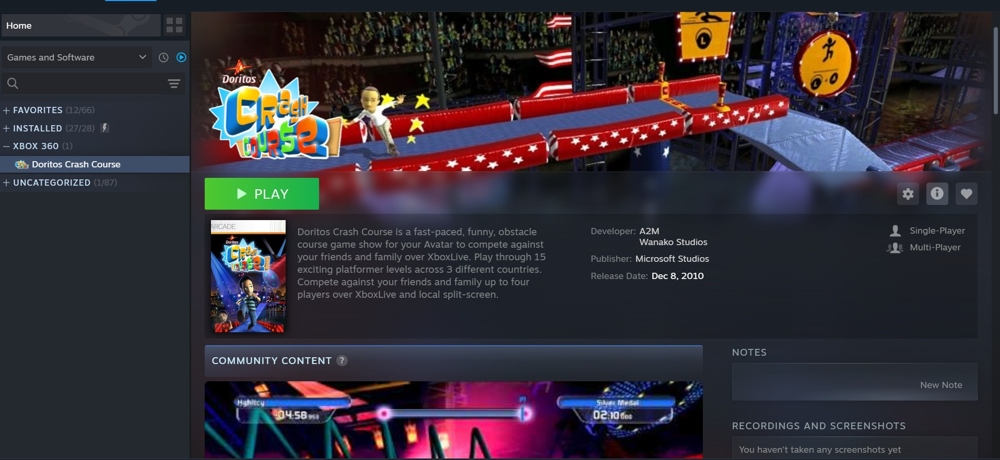

# JMcartridges

A simpler alternative to SteamCartridges

## Install

Run `JMcartridges.Installer.exe` from the [latest release](../../releases/latest).

Or extract `jmcartridges-<version>.zip` into `<Steam>/millennium/plugins/` and enable JMcartridges in Millennium.
